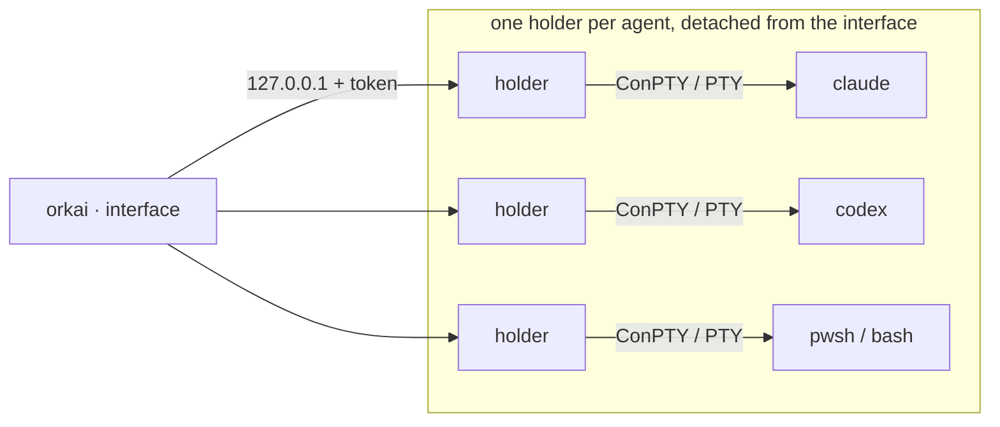

<p align="center">
  
</p>

<p align="center">
  <b>Orchestrate multiple AI agents across multiple projects from a single terminal.</b><br>
  Claude Code, Codex, Kilo, OpenCode, Antigravity, Grok, Qwen Code, Kimi Code and plain terminals side by side, organized into sessions.<br>
  A single native binary with no runtime, for Windows, Linux and macOS.
</p>

<p align="center">
  <a href="https://github.com/lucasmarujo/orkai-cli/actions/workflows/ci.yml"></a>
  <a href="https://github.com/lucasmarujo/orkai-cli/releases/tag/latest"></a>
  
  
  
</p>

<p align="center">
  <a href="#installation">Installation</a> ·
  <a href="#getting-started">Getting started</a> ·
  <a href="#keys">Keys</a> ·
  <a href="#command-line">Command line</a> ·
  <a href="#configuration">Configuration</a> ·
  <a href="#security">Security</a>
</p>

<p align="center">
  <b>English</b> · <a href="README.pt-BR.md">Português (Brasil)</a>
</p>

## orkai in 56 seconds

https://github.com/user-attachments/assets/51c39ecc-d558-4723-806b-dd1427d06b28

<p align="center">
  
  <br>
  <sub>The overview: sessions in the sidebar, counters and plan usage at the top, and every agent live, grouped by project.</sub>
</p>

## Highlights

- **Every agent on one screen.** Claude Code, Codex, Kilo, OpenCode, Antigravity, Grok, Qwen Code, Kimi
  Code and terminals grouped by folder, with status, time, type, a line saying what each one is doing and the
  subagents that Claude Code and Codex spawn.
- **Exact status, instantly.** Hooks, plugins and each agent's own protocols tell when it is working,
  waiting for you or done, without relying on the screen text (see
  [Supported agents](#supported-agents)).
- **You know when you're needed.** Bell, terminal notification, window title and `alt+n` to jump straight
  to the agent that is waiting; or send the alert to your phone.
- **One worktree per agent.** Several agents in the same repository, each on its own branch, with `/diff` and
  `/merge` without leaving orkai.
- **Plan usage in plain sight.** 5-hour, weekly and monthly windows (or the balance) of every agent you're
  logged into, with a countdown to the reset; agents without a login don't show up.
- **Nothing gets lost.** Closing, crashing or updating the interface takes down no agent; after a reboot,
  `ctrl+r` resumes every conversation where it left off.
- **Skills in `/`.** Each agent's skills show up in the autocomplete and start an agent already invoking the
  skill.
- **orkai on your phone, from anywhere.** `ctrl+p` shows a QR code; the phone opens the overview, each
  agent's terminal and creates new agents, end-to-end encrypted (see
  [orkai on your phone](#orkai-on-your-phone-pwa)).
- **A single binary that updates itself.** Every new build is checked by size and SHA-256 before it
  replaces the executable.

## Supported agents

| `who` | Agent | Program | Exact status | Usage in overview | Resume after reboot |
| --- | --- | --- | --- | --- | --- |
| `claude` | Claude Code | `claude` | hooks (`--settings`) | 5h and weekly | `--resume <id>` |
| `codex` | Codex | `codex` | `notify` | 5h and weekly | `codex resume <id>` |
| `kilo` | Kilo CLI | `kilo` | event plugin | balance (`funds`) and Kilo Pass | `--session <id>` |
| `opencode` | OpenCode | `opencode` | event plugin | OpenCode Go (5h and weekly) | `--session <id>` |
| `agy` | Antigravity CLI (successor to Gemini CLI) | `agy` | OSC 7501 | 5h and weekly | `--conversation=<id>` |
| `grok` | Grok Build | `grok` | window title | weekly or monthly | `--resume=<id>` |
| `qwen` | Qwen Code | `qwen` | hooks (system defaults) | no usage API | `--resume <id>` |
| `kimi` | Kimi Code | `kimi` | screen | 5h, weekly or monthly | `--session <id>` |
| `terminal` | PowerShell, bash… | `shell` | output activity | — | reruns the command |

- **Launch.** The task goes into the agent as soon as it is ready. In OpenCode and Kilo it goes through
  `--prompt`, which they send themselves once they finish loading; in the others, orkai types the task and
  presses `enter`. Claude Code, Grok and Qwen Code start with a session id chosen by orkai. For the
  others, orkai finds the session when it is time to resume: through the `session list` of OpenCode/Kilo, the
  `session_index.jsonl` of Kimi Code (`~/.kimi-code`) or the `last_conversations.json` of Antigravity. In
  each case, it is the session of that folder created after the agent and not already used by any other agent.
- **Exact status.** On top of reading the screen, which applies to all of them:
  - OpenCode and Kilo load an orkai plugin (`OPENCODE_CONFIG_CONTENT`/`KILO_CONFIG_CONTENT`, only in
    that process) that reports when the session is working, asks for permission or asks a question, and when it
    goes idle;
  - Qwen Code gets hooks in the Claude Code format through a system defaults file of the agent's own
    (`QWEN_CODE_SYSTEM_DEFAULTS_PATH`), which adds to its hooks;
  - Antigravity is started with `AGY_CLI_OSC7501=on` and reports working, blocked and done through the
    OSC 7501 protocol;
  - Grok Build shows its status in the window title (spinner and `⚠ Action Required`), and so does Qwen Code
    (`◐` and `✳`).

  orkai doesn't touch any of your config files. If you already set one of these variables, it doesn't
  replace it. Grok Build and Kimi Code only accept hooks in the user's global config, so they rely on
  reading the screen and the title.
- **Skills in `/`.** Each agent suggests the skills and commands from the folders it reads itself (see
  [below](#agent-skills-skill)).

## Installation

On Windows, install it with winget or from PowerShell. On Linux and macOS, download the binary for your
platform from the [`latest`](https://github.com/lucasmarujo/orkai-cli/releases/tag/latest) release, rename it
to `orkai` and put it in a folder on your `PATH`:

| Platform | File |
| --- | --- |
| Windows x64 (installer) | `orkai-setup.exe` |
| Linux x64 (static, any distro) | `orkai-x86_64-unknown-linux-musl` |
| macOS Apple Silicon | `orkai-aarch64-apple-darwin` |
| macOS Intel | `orkai-x86_64-apple-darwin` |

**Linux and macOS** (replace `target` with the file for your platform):

```sh
target=orkai-x86_64-unknown-linux-musl
mkdir -p ~/.local/bin
curl -fL -o ~/.local/bin/orkai "https://github.com/lucasmarujo/orkai-cli/releases/download/latest/$target"
chmod +x ~/.local/bin/orkai
```

If `~/.local/bin` isn't on your `PATH` yet, add `export PATH="$HOME/.local/bin:$PATH"` to
`~/.bashrc` or `~/.zshrc`.

**Windows**, with [winget](https://learn.microsoft.com/windows/package-manager/winget/):

```powershell
winget install LucasMarujo.orkai
```

Or, without winget, in PowerShell:

```powershell
$setup = "$env:TEMP\orkai-setup.exe"
Invoke-WebRequest "https://github.com/lucasmarujo/orkai-cli/releases/latest/download/orkai-setup.exe" -OutFile $setup
Start-Process $setup -Wait
```

Both install orkai for your user in `%LOCALAPPDATA%\Programs\orkai`, without admin rights and without a
SmartScreen prompt, and put it on your `PATH` so `orkai` works in any terminal (the PowerShell installer asks
first). Running the installer again upgrades orkai in place, even while it's open, and Settings › Apps or
`winget uninstall LucasMarujo.orkai` uninstalls it.

The installer isn't code signed yet (see [Code signing policy](#code-signing-policy)). If you download
[`orkai-setup.exe`](https://github.com/lucasmarujo/orkai-cli/releases/latest/download/orkai-setup.exe) with a
browser instead, SmartScreen may show "Windows protected your PC": click **More info** › **Run anyway**. All
three get the installer of the newest version, whose file never changes; orkai then updates itself to the
latest build ([auto-update](#auto-update)).

For an unattended install, pass `/VERYSILENT` to the installer (`/MERGETASKS=!addtopath` leaves the `PATH`
alone). The release also carries `orkai-x86_64-pc-windows-msvc`, the bare binary that
[auto-update](#auto-update) downloads; rename it to `orkai.exe` to use orkai without installing it.

Open a new terminal and type `orkai` in PowerShell, Bash or zsh.

> [!IMPORTANT]
> To use an AI agent, its program must be on the `PATH`: `claude`, `codex`, `kilo`, `opencode`,
> `agy`, `grok`, `qwen` or `kimi` (or point to its path in [Configuration](#configuration)).

> [!TIP]
> Keep `orkai` in a folder your user can write to, like the ones in the examples above: the
> [auto-update](#auto-update) replaces the executable itself.

**From source**, with Rust 1.88+ (goes to `~/.cargo/bin`):

```sh
git clone https://github.com/lucasmarujo/orkai-cli.git
cd orkai-cli
cargo install --path .
```

Local builds show up as `dev` and don't auto-update; `orkai update` turns one of them into an official build.

## Getting started

1. Open orkai in any terminal: `orkai`.
2. Pick the project folder with `ctrl+l` (or `/where <folder>`).
3. Pick who runs it with `tab`: one of the installed agents (claude, codex, opencode…) or terminal; `/who <name>`
   picks one directly.
4. Type the task in "write a task" and press `enter`: the agent starts already working on it.
5. `enter` (or a click) opens the agent in a tab; `ctrl+]` goes back to the overview.

You can quit whenever you want (`ctrl+q`): the agents keep running and orkai reconnects to all of them when you open it again.

## The interface

| Area | What it shows |
| --- | --- |
| Sidebar | machine, sessions with the number of active agents in each one, `+ new session` |
| Top | the little pixel-art man, the session's `agents`, `working`, `paused` and `done` counters and, on the right, the usage of the agents you're logged into (see [below](#plan-usage)) |
| List | agents grouped by folder (with the count of each one): number, status, name, time in the current status, lifetime, type (`claude`, `codex`, `kilo`, `opencode`, `agy`, `grok`, `qwen`, `kimi`, `terminal`) and a line saying what the agent is doing; right below each agent, the subagents it spawned that are still running (`↳`, type, how long ago, description and the tool in use) |
| Footer | `write a task`, `pc`, `who`, `worktree`, `bypass` and `where` to launch new agents |

### States

| Symbol | State |
| :---: | --- |
| `⠋` | working |
| `‖` | in yellow, waiting for your answer (approval, question or choice inside the agent) |
| `✔` | done (not seen yet) |
| `●` | idle |
| `$` | terminal |
| `↻` | interrupted (crash/reboot) |
| `✗` | ended |

A terminal where you run an agent (`claude`, `codex`, `kilo`, `opencode`, `agy`, `grok`, `qwen` or
`kimi`) becomes that agent on its own: within 2 seconds the overview shows its type, status
(working, waiting for you, done), subagents and counters just like an agent launched by
orkai. When you exit the agent, it goes back to being a `terminal`. Qwen Code runs on Node and is recognized by
its session registry (`~/.qwen/sessions`), like Claude Code.

### Exact status from hooks

When it launches Claude Code (2.1.78 or newer), orkai passes a `--settings` with async hooks, which don't
slow the agent down. They tell orkai when you send a task, when the agent uses a tool, asks for
permission or asks a question, and when the turn ends. So the status changes instantly, without relying on the
screen text; for example, a final answer that ends with "Would you like to…?" no longer turns into `‖`. In Codex,
orkai uses `notify` to know when the turn ends. The other agents are in
[Supported agents](#supported-agents).

- The hooks add to yours (user, project and plugins) without replacing them. If you already pass
  `--settings` in `claude_args`, or already have a `notify` in the Codex `config.toml`, orkai leaves it alone.
- Each hook only writes the event type and the time to a file inside the agent's folder; the prompt, the commands and
  the answers are never written to disk.
- Reading the screen stays as a fallback: for agents started before this version, older versions of
  Claude Code, interruptions with `esc`, dialogs without a hook (like the one to trust the folder) and, on Windows,
  when there is no Git Bash (Claude Code hooks run in it).

### Alerts

When an agent you're not looking at starts waiting for you (`‖`) or finishes (`✔`):

- the orkai chime plays, in two tones: falling when an agent is waiting for you, rising when it finishes, with
  the timbre of the bell from the launch video, synthesized by orkai itself (on Windows by the system, on macOS by
  `afplay` and on Linux by `paplay`, `pw-play` or `aplay`). Over SSH, or without any of these players, the terminal
  rings the default bell (in Windows Terminal, the taskbar flashes);
- the terminal gets a desktop notification (OSC 9, shown by iTerm2, WezTerm, Ghostty, kitty
  and others);
- the footer shows `<agent> is waiting for you · alt+n opens it`;
- the window title shows how many are waiting and how many are done, across all sessions
  (`‖2 ✔1 · Orkai`), visible in the taskbar even with orkai in the background.

`alt+n` (in the overview or inside any tab) opens the agent that has been waiting the longest; the ones that
are done come next. Inside a tab, the bottom bar shows how many others need you.
Opening the agent marks it as seen. The same agent doesn't chime again for the same reason within 15 s.

To get the alert somewhere else (phone, native system notification), set
`notify_command` (see [Configuration](#configuration)). The command runs on every alert, without a shell, with
these environment variables: `ORKAI_MESSAGE`, `ORKAI_AGENT_ID`, `ORKAI_AGENT_NAME`, `ORKAI_AGENT_KIND`,
`ORKAI_AGENT_STATE` (`paused` or `done`), `ORKAI_SESSION`, `ORKAI_AGENT_CWD` and `ORKAI_AGENT_ACTIVITY`
(the line saying what the agent is doing). It is killed if it runs longer than 30 s.

### Plan usage

To the right of the counters, the overview shows the usage **only of the agents you're logged into**, whether
you're using the agent right now or not; agents without a login don't show up, to keep the screen clean. Each one
gets two lines: the 5-hour window (`5h`) and the weekly one (`week`), or the monthly one (`month`) when the plan has
no week, or the balance (`funds`). Each window has a bar (green, yellow from 70%, red from 90%) and the
countdown to the reset. Up to three agents fit in a column next to the little man; with more, they
split into columns, and only on a narrow screen does the top grow. The values are fetched every 2 minutes, in
the background, with the login the agent itself already keeps on the machine:

- **Claude Code**: `~/.claude/.credentials.json` (or `CLAUDE_CONFIG_DIR`; on macOS, the Keychain);
- **Codex**: `~/.codex/auth.json` (or `CODEX_HOME`), with a ChatGPT login;
- **Kilo CLI**: the Kilo account in `~/.local/share/kilo/auth.json`, with the balance in dollars and the Kilo Pass of the month;
- **OpenCode**: the OpenCode Go key in `~/.local/share/opencode/auth.json` (5h, week and month). Only the Zen key
  shows up as `api key · no plan limits`; other OpenCode providers don't count;
- **Antigravity**: `agy -p /usage --output-format json`, the query `agy` itself makes without spending
  quota (its login lives in the system vault and orkai doesn't read it);
- **Grok Build**: `~/.grok/auth.json` (or `GROK_HOME`/`GROK_AUTH_PATH`), with the weekly or monthly period of the
  subscription;
- **Kimi Code**: `~/.kimi-code/credentials` (or `KIMI_CODE_HOME`), on the endpoint from its `config.toml`.

Qwen Code has no usage API (the free OAuth plan ended in April 2026, and the Coding Plan only
shows usage in the Alibaba Cloud console), so it doesn't show up at the top.

With an expired login it shows `login expired` (opening the agent renews it); if the query fails, the last value
stays on screen with `unavailable`.

## Keys

**Tasks and launching**

| Key | Action |
| --- | --- |
| type + `enter` | starts an agent with the typed task |
| `!command` + `enter` | runs the command in a new terminal, without changing `who` (e.g. `!npm run dev`) |
| `shift+enter` (or `alt+enter`) | line break in the task, without sending; pasting text with several lines also keeps the line breaks |
| `ctrl+↑` (and `ctrl+↓`) | recalls the tasks you already sent in this session; the history is forgotten when orkai closes |
| `tab` / `shift+tab` | picks who runs it among the installed agents and the terminal; `/who <name>` picks any of them |
| `/where <folder>` or `ctrl+l` | picks the session folder (see [below](#choosing-the-folder-where)); clicking a project name does too |
| `ctrl+t` | turns its own worktree on/off for the next agents (see [below](#one-worktree-per-agent-ctrlt)) |
| `/bypass` | turns the permission bypass mode on/off for the next agents (see [below](#bypass-mode-bypass)) |
| `/` | commands (`tab` completes the name): `/where`, `/cd`, `/who`, `/session`, `/new-session`, `/rename-session`, `/delete-session`, `/rename`, `/kill`, `/restart`, `/recover`, `/open`, `/worktree`, `/bypass`, `/diff`, `/merge`, `/help`, `/quit`, plus the skills of the current `who` (see [below](#agent-skills-skill)) |

**Agents**

| Key | Action |
| --- | --- |
| `↑` `↓` / mouse | selects; `enter` or a click opens the agent in a tab |
| `ctrl+]` | leaves the agent's tab and goes back to the overview |
| `shift+pgup` / mouse wheel | agent history |
| `alt+1..9` | jumps to an open tab |
| `alt+n` | opens the next agent waiting for you (or that is done), from any screen |
| `ctrl+e` / `f2` | renames the agent |
| `delete` | stops and removes the selected agent (with empty text), after confirming in the popup |
| `ctrl+x` | stops a running agent / removes an ended one (also asks for confirmation in the popup) |
| `ctrl+r` | recovers the interrupted agents of the session |
| `ctrl+p` · `/pwa` | turns on the orkai PWA and shows the QR code to pair your phone (`/pwa off` turns it off, `/pwa new` changes the code) |

**Sessions and general**

| Key | Action |
| --- | --- |
| `ctrl+n` · `alt+↑↓` | new session · switch session |
| `f1` (or `?` with empty text) | shows/hides help |
| `ctrl+c` / `ctrl+q` | quits orkai; the agents keep running |

Inside an agent's tab every key goes to it (Claude Code, OpenCode, PowerShell, bash…),
including `esc`, arrows, paste and the mouse when the program uses the mouse.

## Choosing the folder (`/where`)

Type `/where ` (or `/cd `) in "write a task". The line below shows, live, the folders
of where you are (current `where`) and filters them as you type. Relative paths start
from the current `where`; `~` is your user folder.

- `tab` with a single possible folder enters it and lists its subfolders right away;
- `tab` with several completes the common prefix and, pressed again, cycles through the options
  (`shift+tab` goes back);
- `enter` sets the folder. Each session remembers its own: when you switch sessions, `where` goes back to
  that session's folder.

`ctrl+l` (or clicking `where`) opens the same picker already filled in with the current folder.

## One worktree per agent (`ctrl+t`)

With `worktree on` in the footer (`ctrl+t`, `/worktree` or a click), each new AI agent starts in its own
[git worktree](https://git-scm.com/docs/git-worktree), on an `orkai/<agent-name>` branch created from
the latest commit of the `where` folder. That way several agents work on the same repository without stepping on
each other, and your checkout stays intact. Terminals (`!command`) keep running straight in the folder.

- The worktree lives in `orkai home`/`worktrees/<agent number>`, in the same repository subfolder you were
  in. Uncommitted changes and files outside git (like `.env`) don't go into it. The agent may
  ask whether you trust the new folder.
- In the list, the agent stays in the project group and shows `⎇ 4 files +12 −3`: what changed since it
  started, counting commits, edits and new files (updated every 10 s). Inside the tab, the bar
  shows the branch.
- `/diff` shows the changes of the selected agent, including new files (`esc` closes, arrows and
  `pgup`/`pgdn` scroll).
- `/merge` (with the agent stopped or done) commits whatever is pending on its branch and merges it into the
  current branch of the repository. If there is a conflict, the merge is undone, the repository stays as it was and
  orkai tells you the command to resolve it by hand. After the merge, the count starts over from zero.
- Deleting the agent (`delete` or `ctrl+x`) also deletes the worktree and the `orkai/…` branch; the popup warns you first.
- On the command line: `orkai new --worktree …`; `orkai rm` also deletes the worktree.

## Bypass mode (`/bypass`)

With `bypass on` in the footer (`/bypass`, `/bypass on|off` or a click), each new AI agent starts already in the
agent's own full permission bypass mode: it runs tools, commands and edits without asking for
approval. Only use it in folders and on machines where you trust that. Terminals (`!command`) don't change.

| Agent | Flag added |
| --- | --- |
| Claude Code | `--dangerously-skip-permissions` |
| Codex | `--dangerously-bypass-approvals-and-sandbox` (also without a sandbox) |
| Kilo CLI | `--auto`, with `KILO_NO_DAEMON=1` (with a daemon running, Kilo ignores `--auto`) |
| OpenCode | `--auto` |
| Antigravity | `--dangerously-skip-permissions` |
| Grok Build | `--always-approve` |
| Qwen Code | `--yolo` |
| Kimi Code | `--auto` (Kimi's `--yolo` still asks on risky actions) |

- The mode is saved with the agent: `ctrl+r`, `/restart` and `orkai recover` resume the conversation still bypassed.
- If the agent args in `config.json` already pick a permission mode (like `-a on-request` in Codex or
  `--approval-mode` in Qwen Code), orkai doesn't add the flag, because the agent would refuse both together.
- The first time, Claude Code asks you to accept bypass mode; the task is only typed after that. Each
  agent's "trust this folder" screens still show up.

## Agent skills (`/skill`)

With an AI agent in `who`, `/` also suggests the skills and commands that agent has, read from
disk and updated on their own (install a skill and it shows up within seconds). The project folders go from
the `where` folder up to the repository root:

- **Claude Code**: `~/.claude/skills`, `~/.claude/commands`, `.claude/skills` and `.claude/commands`, and the
  skills of enabled plugins (`/plugin:skill`);
- **Codex**: `.agents/skills`, `~/.agents/skills` and `~/.codex/skills` (including the system skills);
- **OpenCode** and **Kilo CLI**: `skill(s)` and `command(s)` from `~/.config/opencode` (or `~/.config/kilo`),
  `~/.opencode` (`~/.kilo`) and `.opencode` (`.kilo`, `.kilocode`), plus `.claude/skills` and
  `.agents/skills`; commands in subfolders become `/folder/command`;
- **Antigravity**: `~/.gemini/antigravity-cli/skills` and `.agents/skills` (or the older `.agent/skills`);
- **Grok Build**: `skills` and `commands` from `~/.grok`, `.grok`, `.agents`, `.claude` and `.cursor`;
- **Qwen Code**: `~/.qwen/skills`, `~/.qwen/commands`, `.qwen/skills`, `.qwen/commands` and `.agents/skills`;
- **Kimi Code**: `~/.kimi-code/skills`, `.kimi-code/skills` and `.agents/skills`.

`tab` completes (or extends the common prefix), and `/skill arguments` + `enter` starts an agent already
invoking the skill. In Codex orkai sends it in its format (`$skill arguments`) and in Kimi Code as
`/skill:skill arguments`. orkai's own commands take precedence when the name is the same.

## Command line

```text
orkai ls [-s session]            lists agents with their live status
orkai new -k <agent> -C <folder> [--worktree] <task...>   (claude, codex, kilo, opencode, agy, grok, qwen, kimi, terminal)
orkai send <id> <text...>        types into the agent and presses enter
orkai attach <id>                uses the current terminal straight in the agent (ctrl+] detaches)
orkai logs <id> [-n lines]       recorded transcript of the agent
orkai kill <id> · orkai rm <id>
orkai recover [-s session]       relaunches interrupted agents, resuming the conversation
orkai sessions · orkai home
orkai update                     downloads and installs the newest build
orkai pwa [--tunnel cloudflare|tailscale]   turns on the orkai PWA and prints the QR code
orkai pwa --stop · orkai pwa --new-code     turns it off · forgets the paired phones
```

## orkai on your phone (PWA)

The orkai PWA is your orkai on your phone, from anywhere: the overview with the sessions, the usage and the
live agents; each agent's terminal with its colors; messages, keys (esc, tab, arrows, `1`/`2`/`3` for
permissions, `^c`); new agents with who, where and worktree; stopping, removing, renaming, recovering
interrupted ones, seeing the diff and merging a worktree. The desktop and the phone show the same thing at
the same time.

### How to use

1. In orkai, press `ctrl+p` (or click **▣ orkai pwa** in the sidebar, or type `/pwa`). It stays on until
   you turn it off, even after closing and reopening orkai.
2. Point your phone's camera at the QR code. The browser opens orkai already paired. Without the camera,
   click **copy** under the `link` shown next to the code (or press `c`), send it to the phone and open it
   there, or paste it into the page the address opens.
3. Optional: *share › add to home screen* puts orkai one tap away, like an app.

The sidebar shows `off`, `on` or how many phones are connected (`● 2`). On the PWA screen, `d` turns it off
and `n` generates a new code and a new address, which disconnects and forgets the phones already paired.
Turning it off in one orkai window turns it off in all of them, and it stays off until you turn it on.
The bridge writes what happens to the tunnel and the phones in `pwa.log`, in the data folder.

From the terminal:

```sh
orkai pwa                        # turns it on and prints the QR code
orkai pwa --tunnel tailscale     # uses your tailnet instead of cloudflare
orkai pwa --new-code             # forgets the paired phones
orkai pwa --stop                 # turns it off
```

### How the phone reaches the computer

orkai starts a light bridge in a separate process, which listens **only on `127.0.0.1`** and serves the app
itself. It doesn't weigh on orkai: it only exists while the PWA is on and, with no phone connected, it sits
idle. The bridge only connects to the agents while a phone is open, and only sends the phone what changed:
the overview when a state changes and, in the terminal, only the screen rows that changed.

To work away from home without opening ports on your router, orkai uses a tunnel that only carries bytes:

- **cloudflare** (default, no account): a Cloudflare *quick tunnel*. The first time, orkai downloads the
  official `cloudflared` from `github.com/cloudflare/cloudflared` into the `bin/` folder and checks the
  published SHA-256 before using it. If `cloudflared` is already on the `PATH`, it uses that one. The
  tunnel is saved in `pwa-tunnel.json`, so the address stays the same when the internet drops and comes
  back, when `cloudflared` or the bridge restarts and when the PWA is turned off and on again within a few
  minutes: the phone reconnects by itself, even away from home. Cloudflare deletes a quick tunnel that has
  been offline for longer (somewhere between 5 and 20 minutes), for example while the computer is off or
  asleep; orkai then opens a new one and the new QR code shows up on its own, as it does after
  `n`/`--new-code`. For an address that never changes, use tailscale.
- **tailscale**: the phone talks to the computer **peer to peer** over your tailnet (`tailscale serve`),
  with a fixed address. The phone needs to be on the same tailnet.

No server of yours or of orkai sits in the middle.

### Security

- The QR code carries a 256-bit secret in the URL **fragment** (`#k=…`). The browser never sends the
  fragment over the network, so the tunnel doesn't see the secret. The app removes the fragment from the
  address bar and keeps the secret only on that phone.
- Each connection does a fresh ECDH P-256 exchange and derives, with HKDF-SHA256 salted by the secret and
  bound to both public keys, one AES-256-GCM key for each direction. Whoever doesn't have the secret can't
  derive the keys, and the bridge closes the connection on the first frame that doesn't authenticate.
- The nonce of each frame is a counter. A repeated, lost or out-of-order frame doesn't open, so the tunnel
  can't resend a command already typed.
- The bridge accepts at most 8 connections, gives pairing 10 s and responds with a strict CSP, without
  `unsafe-inline`.
- A paired phone controls your agents (and the terminals) just like you at the keyboard. `n` on the PWA
  screen or `orkai pwa --new-code` forgets every phone at once.

## Auto-update

Every push to `main` goes through the tests on the three systems and becomes a new build in the
`latest` release, with a `manifest.json` holding the commit and the SHA-256 of each binary.

Every time you open `orkai`, it checks that manifest (short timeout; without internet,
it opens right away). If there is a newer build, it downloads the binary for your platform, checks
size and SHA-256, replaces its own executable and opens already updated. Running
agents aren't affected, because they run from their own copies of the binary.

- `orkai update` updates right away (it also turns a local build into an official build);
- `orkai --version` shows the version and the commit (`dev` for local builds, which don't
  auto-update);
- `ORKAI_NO_UPDATE=1` turns the check off; `ORKAI_UPDATE_URL` points to another
  build server.

## Persistence and recovery

Each agent runs inside its own detached `holder` process, which owns the pseudo-terminal
(ConPTY on Windows, PTY on Unix). The interface only connects to them.



That's why:

- **Closing, restarting or updating orkai takes down no agent.** When you open it again, it
  reconnects to all of them. The holder runs from a copy of the binary in `bin/`, so you can
  rebuild and reinstall `orkai` with agents running.
- **If the interface freezes**, the agents keep going untouched.
- **If a holder dies or the machine reboots**, the agent shows up as `↻ interrupted`.
  `ctrl+r` (or `orkai recover`) relaunches all the interrupted agents of the session, each one in
  its folder: Claude Code comes back with `--resume <conversation id>` (orkai starts every Claude
  with a known `--session-id`), Codex with `codex resume <id>`, the other agents as in
  [Supported agents](#supported-agents), and the terminals rerun the original command.
- All the output of each agent is recorded (with rotation) in `agents/<id>/output.log`. Opening an
  ended or interrupted agent shows the last screen, and `orkai logs <id>` prints the transcript.

The data lives in `orkai home`:

| System | Folder |
| --- | --- |
| Windows | `%LOCALAPPDATA%\orkai` |
| Linux | `~/.local/share/orkai` |
| macOS | `~/Library/Application Support/orkai` |

The `ORKAI_HOME` variable changes this location.

## Configuration

`config.json` inside the data folder (created on the first run):

```json
{
  "shell": null,
  "shell_args": [],
  "claude_command": "claude",
  "claude_args": [],
  "codex_command": "codex",
  "codex_args": [],
  "kilo_command": "kilo",
  "kilo_args": [],
  "opencode_command": "opencode",
  "opencode_args": [],
  "agy_command": "agy",
  "agy_args": [],
  "grok_command": "grok",
  "grok_args": [],
  "qwen_command": "qwen",
  "qwen_args": [],
  "kimi_command": "kimi",
  "kimi_args": [],
  "notify": true,
  "notify_sound": true,
  "notify_command": null,
  "notify_args": [],
  "pwa_tunnel": "cloudflare",
  "pwa_port": 7470
}
```

A null `shell` uses `pwsh`/`powershell` on Windows and `$SHELL` on Unix.
Examples: `"claude_args": ["--model", "opus"]`, `"opencode_args": ["-m", "opencode/big-pickle"]`. Fields
missing from the file use the default, so an old `config.json` still works.

`pwa_tunnel` picks the orkai PWA tunnel (`cloudflare` or `tailscale`) and `pwa_port` the bridge's local
port, which only listens on `127.0.0.1`.

`notify: false` turns off the chime, the bell and the terminal notification; `notify_sound: false` swaps the orkai
chime for the terminal's default bell. `notify_command` works independently of them;
for example, to send it to your phone through [ntfy](https://ntfy.sh):

```json
"notify_command": "sh",
"notify_args": ["-c", "curl -s -d \"$ORKAI_MESSAGE\" ntfy.sh/my-topic"]
```

Every Claude Code started or resumed by orkai opens with Remote Control on
(`--remote-control`), so any session can be continued in the Claude app or at
claude.ai/code. Codex has no equivalent for the interactive session in the terminal.

## Terminal icons

No terminal lets a program change the icon of a tab that is already open, so orkai uses what each terminal
offers. When orkai opens:

- **Windows Terminal**: the `orkai` profile, with the sailor icon, shows up in the `+` menu (a
  [fragment](https://learn.microsoft.com/windows/terminal/json-fragment-extensions) in
  `%LOCALAPPDATA%\Microsoft\Windows Terminal\Fragments\orkai`). Open orkai through it, or make it your default
  profile, and the tab shows the icon. `orkai.exe` carries the icon too (Explorer, taskbar, Alt+Tab).
- **iTerm2**: a dynamic profile `orkai · <your profile>` inherits everything from the tab's profile and only swaps the
  icon; the tab uses that profile while orkai is open and goes back to yours when you quit. The first time, the icon
  shows up after iTerm2 loads the new profile (about a second).
- **Linux**: the `orkai` shortcut goes into the applications menu (`~/.local/share/applications/orkai.desktop`);
  Linux terminals don't show an icon per tab.

These are new files in the folders each terminal sets aside for extensions; the Windows Terminal `settings.json`
and your iTerm2 profiles aren't changed. Local builds (`dev`) don't create anything, and
`ORKAI_NO_TERMINAL_PROFILE=1` turns it off.

## Security

- Holders listen only on `127.0.0.1`, on a random port, and require a 256-bit
  token per agent, which lives only in the user's data folder (`0700`/`0600` permissions on Unix).
- To show usage, orkai reads each agent's login token in memory only and sends it only, over
  HTTPS, to the service that issued it (`api.anthropic.com`, `chatgpt.com`, `api.kilo.ai`, `opencode.ai`,
  `cli-chat-proxy.grok.com` and the HTTPS `base_url` of Kimi Code); it is never written, logged or
  renewed by orkai. The Antigravity login isn't read: `agy` itself makes the query.
- `.cmd`/`.bat` commands on Windows only get arguments without cmd special characters; a task with
  any of them is typed into the agent's terminal. npm shims that only forward to an `.exe` (like the
  OpenCode one) run the `.exe` directly, without cmd.exe.
- The Claude Code and Qwen Code hooks, the Codex `notify` and the OpenCode and Kilo plugin call the orkai copy
  in `bin/` and only write the event type (working, waiting for you, done) to the agent's folder;
  the content received from the agent is discarded in memory. The hook files and the plugin live in the
  agent's folder and only apply to the process orkai launched; none of your config files is changed.
- The profile with the icon (see [Terminal icons](#terminal-icons)) only points to the orkai executable and
  to the icon image, saved in the data folder.
- The orkai PWA bridge listens only on `127.0.0.1` and only accepts the phone that has the QR code's
  secret (see [orkai on your phone](#orkai-on-your-phone-pwa)). The tunnel never gets the secret, which
  travels in the URL fragment, and only carries AES-256-GCM frames with a counter nonce.

## Code signing policy

`orkai.exe` and `orkai-setup.exe` are not code signed yet. Until they are, Windows SmartScreen may warn about
an `orkai-setup.exe` downloaded with a browser; winget and the PowerShell command in
[Installation](#installation) don't get the prompt.

The [CI](.github/workflows/ci.yml) is ready to sign both files through [SignPath](https://about.signpath.io)
once the [SignPath Foundation](https://signpath.org) accepts orkai: only builds of this repository are signed,
and every signing request is approved by hand.

- Committers and reviewers: [Lucas Marujo](https://github.com/lucasmarujo)
- Approvers: [Lucas Marujo](https://github.com/lucasmarujo)

**Privacy.** orkai has no telemetry and sends nothing about you or your projects. It only uses the network
for:

- updates: each time it opens, it reads the `manifest.json` of this repository's `latest` release on GitHub
  and downloads the new build when there is one (`ORKAI_NO_UPDATE=1` turns it off, see
  [Auto-update](#auto-update));
- plan usage: each agent's login token goes only to the service that issued it (see Security, above);
- the orkai PWA, only after you turn it on: the Cloudflare quick tunnel, with `cloudflared` downloaded from
  Cloudflare's GitHub release, and a query to `cloudflare-dns.com` that waits for the tunnel's address to
  exist before showing the QR code; or `tailscale serve`;
- the Windows Terminal profile, whose icon Windows Terminal loads from `https://orkai.marujo.dev/orkai.ico`.

## Development

```sh
cargo test        # unit + e2e with a real PTY (holder and the TUI itself)
cargo clippy --all-targets -- -D warnings
cargo fmt --check
```

CI runs all three on Windows, Linux and macOS on every push to `main` and on every pull request; every push to
`main` that passes becomes the [`latest`](https://github.com/lucasmarujo/orkai-cli/releases/tag/latest) release.
The Windows installer is built from [`installer/orkai.iss`](installer/orkai.iss) (see
[`installer/README.md`](installer/README.md)).

## License

[MIT](LICENSE).

---

<p align="center">
  <br>
  <sub><a href="https://github.com/lucasmarujo/orkai-cli/issues">Report an issue</a> · <a href="https://github.com/lucasmarujo/orkai-cli/releases/tag/latest">Download the latest build</a></sub>
</p>
