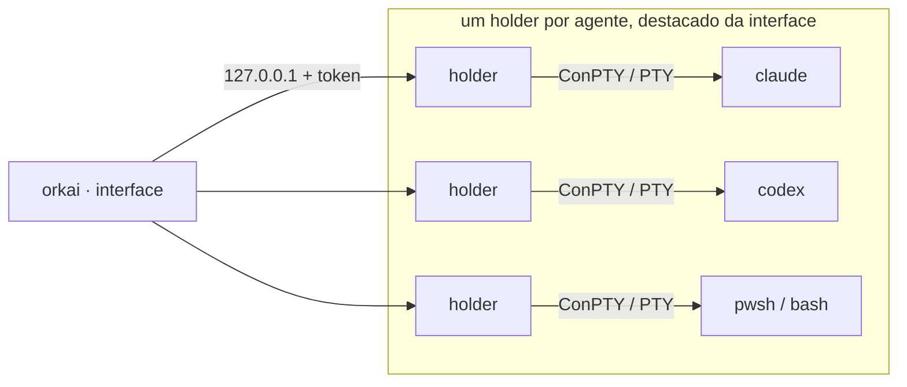

<p align="center">
  
</p>

<p align="center">
  <b>Orquestre vários agentes de IA em vários projetos, de um terminal só.</b><br>
  Claude Code, Codex, Kilo, OpenCode, Antigravity, Grok, Qwen Code, Kimi Code e terminais comuns lado a lado, organizados em sessões.<br>
  Binário único, nativo e sem runtime, para Windows, Linux e macOS.
</p>

<p align="center">
  <a href="https://github.com/lucasmarujo/orkai-cli/actions/workflows/ci.yml"></a>
  <a href="https://github.com/lucasmarujo/orkai-cli/releases/tag/latest"></a>
  
  
  
</p>

<p align="center">
  <a href="#instalação">Instalação</a> ·
  <a href="#primeiros-passos">Primeiros passos</a> ·
  <a href="#teclas">Teclas</a> ·
  <a href="#linha-de-comando">Linha de comando</a> ·
  <a href="#configuração">Configuração</a> ·
  <a href="#segurança">Segurança</a>
</p>

<p align="center">
  <a href="README.md">English</a> · <b>Português (Brasil)</b>
</p>

## O orkai em 56 segundos

https://github.com/user-attachments/assets/51c39ecc-d558-4723-806b-dd1427d06b28

<p align="center">
  
  <br>
  <sub>A visão geral: sessões na lateral, contadores e consumo dos planos no topo, e cada agente ao vivo, agrupado por projeto.</sub>
</p>

## Destaques

- **Todos os agentes numa tela.** Claude Code, Codex, Kilo, OpenCode, Antigravity, Grok, Qwen Code, Kimi
  Code e terminais agrupados por pasta, com estado, tempo, tipo, a frase do que cada um está fazendo e os
  subagents que o Claude Code e o Codex disparam.
- **Estado exato, na hora.** Hooks, plugins e os protocolos de cada agente dizem quando ele está
  trabalhando, esperando você ou terminou, sem depender do texto da tela (veja
  [Agentes suportados](#agentes-suportados)).
- **Você sabe quando precisam de você.** Sino, notificação do terminal, título da janela e `alt+n` para abrir
  direto o agente que está esperando; ou mande o aviso para o celular.
- **Uma worktree por agente.** Vários agentes no mesmo repositório, cada um na sua branch, com `/diff` e
  `/merge` sem sair do orkai.
- **Consumo dos planos à vista.** Janelas de 5 horas, semana e mês (ou o saldo) de cada agente em que você
  está logado, com contagem regressiva até o reset; quem não tem login não aparece.
- **Nada se perde.** Fechar, travar ou atualizar a interface não derruba nenhum agente; depois de um reboot,
  `ctrl+r` retoma cada conversa de onde parou.
- **Skills no `/`.** As skills de cada agente aparecem no autocomplete e iniciam um agente já invocando a
  skill.
- **O orkai no celular, de qualquer lugar.** `ctrl+p` mostra um QR code; o celular abre o overview, o
  terminal de cada agente e cria agentes novos, cifrado de ponta a ponta (veja
  [O orkai no celular](#o-orkai-no-celular-pwa)).
- **Binário único que se atualiza sozinho.** Cada build nova é conferida por tamanho e SHA-256 antes de
  substituir o executável.

## Agentes suportados

| `who` | Agente | Programa | Estado exato | Consumo no overview | Retomada após reboot |
| --- | --- | --- | --- | --- | --- |
| `claude` | Claude Code | `claude` | hooks (`--settings`) | 5h e semana | `--resume <id>` |
| `codex` | Codex | `codex` | `notify` | 5h e semana | `codex resume <id>` |
| `kilo` | Kilo CLI | `kilo` | plugin de eventos | saldo (`funds`) e Kilo Pass | `--session <id>` |
| `opencode` | OpenCode | `opencode` | plugin de eventos | OpenCode Go (5h e semana) | `--session <id>` |
| `agy` | Antigravity CLI (sucessor do Gemini CLI) | `agy` | OSC 7501 | 5h e semana | `--conversation=<id>` |
| `grok` | Grok Build | `grok` | título da janela | semana ou mês | `--resume=<id>` |
| `qwen` | Qwen Code | `qwen` | hooks (system defaults) | sem API de consumo | `--resume <id>` |
| `kimi` | Kimi Code | `kimi` | tela | 5h, semana ou mês | `--session <id>` |
| `terminal` | PowerShell, bash… | `shell` | atividade da saída | — | reexecuta o comando |

- **Lançamento.** A tarefa entra no agente assim que ele fica pronto. No OpenCode e no Kilo ela vai pelo
  `--prompt`, que eles mesmos enviam quando terminam de carregar; nos outros, o orkai digita a tarefa e
  aperta `enter`. O Claude Code, o Grok e o Qwen Code nascem com um id de sessão escolhido pelo orkai. Nos
  outros, o orkai descobre a sessão na hora de retomar: pelo `session list` do OpenCode/Kilo, pelo
  `session_index.jsonl` do Kimi Code (`~/.kimi-code`) ou pelo `last_conversations.json` do Antigravity. Em
  cada caso, é a sessão daquela pasta criada depois do agente e que nenhum outro agente já usa.
- **Estado exato.** Além da leitura da tela, que vale para todos:
  - OpenCode e Kilo carregam um plugin do orkai (`OPENCODE_CONFIG_CONTENT`/`KILO_CONFIG_CONTENT`, só
    naquele processo) que avisa quando a sessão trabalha, pede permissão ou faz uma pergunta, e quando fica
    ociosa;
  - o Qwen Code recebe hooks no formato do Claude Code por um arquivo de system defaults próprio do agente
    (`QWEN_CODE_SYSTEM_DEFAULTS_PATH`), que soma aos seus hooks;
  - o Antigravity é iniciado com `AGY_CLI_OSC7501=on` e informa trabalhando, bloqueado e terminado pelo
    protocolo OSC 7501;
  - o Grok Build mostra o estado no título da janela (spinner e `⚠ Action Required`), e o Qwen Code também
    (`◐` e `✳`).

  O orkai não mexe em nenhum arquivo de configuração seu. Se você já define uma dessas variáveis, ele não a
  substitui. O Grok Build e o Kimi Code só aceitam hooks na configuração global do usuário, então ficam
  na leitura da tela e do título.
- **Skills no `/`.** Cada agente sugere as skills e os comandos das pastas que ele mesmo lê (veja
  [abaixo](#skills-dos-agentes-skill)).

## Instalação

No Windows, instale pelo winget ou pelo PowerShell. No Linux e no macOS, baixe o binário da sua plataforma
na release [`latest`](https://github.com/lucasmarujo/orkai-cli/releases/tag/latest), renomeie para `orkai` e
coloque numa pasta do `PATH`:

| Plataforma | Arquivo |
| --- | --- |
| Windows x64 (instalador) | `orkai-setup.exe` |
| Linux x64 (estático, qualquer distro) | `orkai-x86_64-unknown-linux-musl` |
| macOS Apple Silicon | `orkai-aarch64-apple-darwin` |
| macOS Intel | `orkai-x86_64-apple-darwin` |

**Linux e macOS** (troque `target` pelo arquivo da sua plataforma):

```sh
target=orkai-x86_64-unknown-linux-musl
mkdir -p ~/.local/bin
curl -fL -o ~/.local/bin/orkai "https://github.com/lucasmarujo/orkai-cli/releases/download/latest/$target"
chmod +x ~/.local/bin/orkai
```

Se `~/.local/bin` ainda não estiver no `PATH`, adicione `export PATH="$HOME/.local/bin:$PATH"` ao
`~/.bashrc` ou ao `~/.zshrc`.

**Windows**, pelo [winget](https://learn.microsoft.com/windows/package-manager/winget/):

```powershell
winget install LucasMarujo.orkai
```

Ou, sem o winget, no PowerShell:

```powershell
$setup = "$env:TEMP\orkai-setup.exe"
Invoke-WebRequest "https://github.com/lucasmarujo/orkai-cli/releases/latest/download/orkai-setup.exe" -OutFile $setup
Start-Process $setup -Wait
```

Os dois instalam o orkai para o seu usuário em `%LOCALAPPDATA%\Programs\orkai`, sem pedir administrador e sem
o aviso do SmartScreen, e o colocam no `PATH` para o `orkai` funcionar em qualquer terminal (o instalador do
PowerShell pergunta antes). Rodar o instalador de novo atualiza o orkai no lugar, mesmo com ele aberto, e
Configurações › Aplicativos ou `winget uninstall LucasMarujo.orkai` desinstala.

O instalador ainda não é assinado (veja a [Code signing policy](#code-signing-policy)). Se você baixar o
[`orkai-setup.exe`](https://github.com/lucasmarujo/orkai-cli/releases/latest/download/orkai-setup.exe) pelo
navegador, o SmartScreen pode mostrar "O Windows protegeu o computador": clique em **Mais informações** ›
**Executar assim mesmo**. Os três baixam o instalador da versão mais nova, cujo arquivo nunca muda; depois o
orkai se atualiza sozinho para a última build ([atualização automática](#atualização-automática)).

Para instalar sem perguntas, passe `/VERYSILENT` ao instalador (`/MERGETASKS=!addtopath` não mexe no
`PATH`). A release também traz o `orkai-x86_64-pc-windows-msvc`, o binário puro que a
[atualização automática](#atualização-automática) baixa; renomeie para `orkai.exe` para usar o orkai sem
instalar.

Abra um terminal novo e digite `orkai` no PowerShell, Bash ou zsh.

> [!IMPORTANT]
> Para usar um agente de IA, o programa dele precisa estar no `PATH`: `claude`, `codex`, `kilo`, `opencode`,
> `agy`, `grok`, `qwen` ou `kimi` (ou aponte o caminho em [Configuração](#configuração)).

> [!TIP]
> Deixe o `orkai` numa pasta em que o seu usuário possa escrever, como as dos exemplos acima: a
> [atualização automática](#atualização-automática) substitui o próprio executável.

**Do código-fonte**, com Rust 1.88+ (vai para `~/.cargo/bin`):

```sh
git clone https://github.com/lucasmarujo/orkai-cli.git
cd orkai-cli
cargo install --path .
```

Builds locais aparecem como `dev` e não se auto-atualizam; `orkai update` converte uma delas em build oficial.

## Primeiros passos

1. Abra o orkai em qualquer terminal: `orkai`.
2. Escolha a pasta do projeto com `ctrl+l` (ou `/where <pasta>`).
3. Escolha quem executa com `tab`: um dos agentes instalados (claude, codex, opencode…) ou terminal; `/who <nome>`
   escolhe direto.
4. Escreva a tarefa no "write a task" e aperte `enter`: o agente nasce já trabalhando nela.
5. `enter` (ou um clique) abre o agente numa aba; `ctrl+]` volta para a visão geral.

Pode sair quando quiser (`ctrl+q`): os agentes continuam rodando e o orkai reconecta em todos ao abrir de novo.

## A interface

| Área | O que mostra |
| --- | --- |
| Lateral | máquina, sessões com o número de agentes ativos em cada uma, `+ new session` |
| Topo | o homenzinho pixelado, os contadores `agents`, `working`, `paused` e `done` da sessão e, à direita, o consumo dos agentes em que você está logado (veja [abaixo](#consumo-dos-planos)) |
| Lista | agentes agrupados por pasta (com a contagem de cada uma): número, estado, nome, tempo no estado atual, tempo de vida, tipo (`claude`, `codex`, `kilo`, `opencode`, `agy`, `grok`, `qwen`, `kimi`, `terminal`) e a frase do que o agente está fazendo; logo abaixo de cada agente, os subagents que ele disparou e ainda estão rodando (`↳`, tipo, há quanto tempo, descrição e a ferramenta em uso) |
| Rodapé | `write a task`, `pc`, `who`, `worktree`, `bypass` e `where` para lançar novos agentes |

### Estados

| Símbolo | Estado |
| :---: | --- |
| `⠋` | trabalhando |
| `‖` | em amarelo, esperando você responder (aprovação, pergunta ou escolha dentro do agente) |
| `✔` | terminou (ainda não visto) |
| `●` | ocioso |
| `$` | terminal |
| `↻` | interrompido (crash/reboot) |
| `✗` | encerrado |

Um terminal em que você roda um agente (`claude`, `codex`, `kilo`, `opencode`, `agy`, `grok`, `qwen` ou
`kimi`) vira esse agente sozinho: em até 2 segundos o overview passa a mostrar o tipo, o estado
(trabalhando, esperando você, terminou), os subagents e os contadores como os de um agente lançado pelo
orkai. Ao sair do agente, volta a ser `terminal`. O Qwen Code roda sobre o Node e é reconhecido pelo registro
de sessões dele (`~/.qwen/sessions`), como o Claude Code.

### Estado exato pelos hooks

Ao lançar o Claude Code (2.1.78 ou mais novo), o orkai passa um `--settings` com hooks assíncronos, que não
atrasam o agente. Eles avisam o orkai quando você envia uma tarefa, quando o agente usa uma ferramenta, pede
permissão ou faz uma pergunta, e quando o turno termina. Assim o estado muda na hora, sem depender do texto
da tela; por exemplo, uma resposta final que termina com "Would you like to…?" não vira mais `‖`. No Codex,
o orkai usa o `notify` para saber quando o turno termina. Os outros agentes estão em
[Agentes suportados](#agentes-suportados).

- Os hooks somam-se aos seus (do usuário, do projeto e dos plugins), sem substituí-los. Se você já passa
  `--settings` em `claude_args`, ou já tem um `notify` no `config.toml` do Codex, o orkai não mexe.
- Cada hook só grava o tipo do evento e a hora num arquivo dentro da pasta do agente; o prompt, os comandos e
  as respostas nunca são gravados em disco.
- A leitura da tela continua como reserva: para agentes iniciados antes desta versão, versões antigas do
  Claude Code, interrupções com `esc`, diálogos sem hook (como o de confiar na pasta) e, no Windows, quando
  não há Git Bash (os hooks do Claude Code rodam nele).

### Avisos

Quando um agente que você não está olhando passa a esperar você (`‖`) ou termina (`✔`):

- toca o sininho do orkai, em dois tons: descendo quando um agente espera você, subindo quando termina, com o
  timbre do sino do vídeo de lançamento, sintetizado pelo próprio orkai (no Windows pelo sistema, no macOS pelo
  `afplay` e no Linux pelo `paplay`, `pw-play` ou `aplay`). Por SSH, ou sem nenhum desses players, o terminal
  toca o sino padrão (no Windows Terminal, a barra de tarefas pisca);
- o terminal recebe uma notificação de área de trabalho (OSC 9, mostrada pelo iTerm2, WezTerm, Ghostty, kitty
  e outros);
- o rodapé avisa `<agente> is waiting for you · alt+n opens it`;
- o título da janela mostra quantos estão esperando e quantos terminaram, em todas as sessões
  (`‖2 ✔1 · Orkai`), visível na barra de tarefas mesmo com o orkai em segundo plano.

`alt+n` (no overview ou dentro de qualquer aba) abre o agente que espera há mais tempo; os que
terminaram vêm depois. Dentro de uma aba, a barra de baixo mostra quantos outros precisam de você.
Abrir o agente marca como visto. Um mesmo agente não toca de novo pelo mesmo motivo em menos de 15 s.

Para receber o aviso em outro lugar (celular, notificação nativa do sistema), configure
`notify_command` (veja [Configuração](#configuração)). O comando roda a cada aviso, sem shell, com
estas variáveis de ambiente: `ORKAI_MESSAGE`, `ORKAI_AGENT_ID`, `ORKAI_AGENT_NAME`, `ORKAI_AGENT_KIND`,
`ORKAI_AGENT_STATE` (`paused` ou `done`), `ORKAI_SESSION`, `ORKAI_AGENT_CWD` e `ORKAI_AGENT_ACTIVITY`
(a frase do que o agente está fazendo). Ele é encerrado se passar de 30 s.

### Consumo dos planos

À direita dos contadores, o overview mostra o consumo **só dos agentes em que você está logado**, use você
o agente agora ou não; quem não tem login não aparece, para a tela não poluir. Para cada um aparecem duas
linhas: a janela de 5 horas (`5h`) e a semanal (`week`), ou a mensal (`month`) quando o plano não tem semana,
ou o saldo (`funds`). Cada janela tem uma barra (verde, amarela a partir de 70%, vermelha a partir de 90%) e a
contagem regressiva até o reset. Até três agentes ficam numa coluna ao lado do homenzinho; com mais, eles
se dividem em colunas, e só numa tela estreita o topo cresce. Os valores são consultados a cada 2 minutos, em
segundo plano, com o login que o próprio agente já guarda na máquina:

- **Claude Code**: `~/.claude/.credentials.json` (ou `CLAUDE_CONFIG_DIR`; no macOS, o Keychain);
- **Codex**: `~/.codex/auth.json` (ou `CODEX_HOME`), com login do ChatGPT;
- **Kilo CLI**: a conta Kilo em `~/.local/share/kilo/auth.json`, com o saldo em dólar e o Kilo Pass do mês;
- **OpenCode**: a chave do OpenCode Go em `~/.local/share/opencode/auth.json` (5h, semana e mês). Só a chave
  do Zen aparece como `api key · no plan limits`; outros provedores do OpenCode não contam;
- **Antigravity**: `agy -p /usage --output-format json`, a consulta que o próprio `agy` faz sem gastar
  quota (o login dele fica no cofre do sistema e o orkai não o lê);
- **Grok Build**: `~/.grok/auth.json` (ou `GROK_HOME`/`GROK_AUTH_PATH`), com o período semanal ou mensal da
  assinatura;
- **Kimi Code**: `~/.kimi-code/credentials` (ou `KIMI_CODE_HOME`), no endpoint do `config.toml` dele.

O Qwen Code não tem API de consumo (o plano gratuito por OAuth acabou em abril de 2026, e o Coding Plan só
mostra o uso no console da Alibaba Cloud), então ele não aparece no topo.

Com o login vencido aparece `login expired` (abrir o agente renova); se a consulta falhar, o último valor
continua na tela com `unavailable`.

## Teclas

**Tarefas e lançamento**

| Tecla | Ação |
| --- | --- |
| digitar + `enter` | inicia um agente com a tarefa digitada |
| `!comando` + `enter` | roda o comando num terminal novo, sem mudar o `who` (ex.: `!npm run dev`) |
| `shift+enter` (ou `alt+enter`) | quebra de linha na tarefa, sem enviar; colar um texto com várias linhas também mantém as quebras |
| `ctrl+↑` (e `ctrl+↓`) | recupera as tarefas que você já mandou nesta sessão; o histórico é esquecido quando o orkai fecha |
| `tab` / `shift+tab` | escolhe quem executa entre os agentes instalados e o terminal; `/who <nome>` escolhe qualquer um |
| `/where <pasta>` ou `ctrl+l` | escolhe a pasta da sessão (veja [abaixo](#escolhendo-a-pasta-where)); clicar no nome de um projeto também |
| `ctrl+t` | liga/desliga a worktree própria para os próximos agentes (veja [abaixo](#uma-worktree-por-agente-ctrlt)) |
| `/bypass` | liga/desliga o modo bypass de permissões para os próximos agentes (veja [abaixo](#modo-bypass-bypass)) |
| `/` | comandos (`tab` completa o nome): `/where`, `/cd`, `/who`, `/session`, `/new-session`, `/rename-session`, `/delete-session`, `/rename`, `/kill`, `/restart`, `/recover`, `/open`, `/worktree`, `/bypass`, `/diff`, `/merge`, `/help`, `/quit`, além das skills do `who` atual (veja [abaixo](#skills-dos-agentes-skill)) |

**Agentes**

| Tecla | Ação |
| --- | --- |
| `↑` `↓` / mouse | seleciona; `enter` ou clique abre o agente numa aba |
| `ctrl+]` | sai da aba do agente e volta para a visão geral |
| `shift+pgup` / roda do mouse | histórico do agente |
| `alt+1..9` | pula para uma aba aberta |
| `alt+n` | abre o próximo agente esperando você (ou que terminou), de qualquer tela |
| `ctrl+e` / `f2` | renomeia o agente |
| `delete` | para e remove o agente selecionado (com o texto vazio), após confirmar no popup |
| `ctrl+x` | encerra um agente em execução / remove um encerrado (também pede confirmação no popup) |
| `ctrl+r` | recupera os agentes interrompidos da sessão |
| `ctrl+p` · `/pwa` | liga o orkai PWA e mostra o QR code para parear o celular (`/pwa off` desliga, `/pwa new` troca o código) |

**Sessões e geral**

| Tecla | Ação |
| --- | --- |
| `ctrl+n` · `alt+↑↓` | nova sessão · troca de sessão |
| `f1` (ou `?` com o texto vazio) | mostra/esconde a ajuda |
| `ctrl+c` / `ctrl+q` | sai do orkai; os agentes continuam rodando |

Dentro da aba de um agente todas as teclas vão para ele (Claude Code, OpenCode, PowerShell, bash…),
inclusive `esc`, setas, colagem e mouse quando o programa usa mouse.

## Escolhendo a pasta (`/where`)

Digite `/where ` (ou `/cd `) no "write a task". A linha de baixo mostra, ao vivo, as pastas
de onde você está (`where` atual) e vai filtrando conforme você digita. Caminhos relativos partem
do `where` atual; `~` é a sua pasta de usuário.

- `tab` com uma única pasta possível entra nela e já lista as subpastas;
- `tab` com várias completa o prefixo comum e, apertado de novo, percorre as opções
  (`shift+tab` volta);
- `enter` define a pasta. Cada sessão lembra a sua: ao trocar de sessão, o `where` volta para
  a pasta daquela sessão.

`ctrl+l` (ou clicar em `where`) abre o mesmo seletor já preenchido com a pasta atual.

## Uma worktree por agente (`ctrl+t`)

Com `worktree on` no rodapé (`ctrl+t`, `/worktree` ou clique), cada novo agente de IA nasce numa
[worktree do git](https://git-scm.com/docs/git-worktree) própria, numa branch `orkai/<nome-do-agente>` criada a
partir do último commit da pasta do `where`. Assim vários agentes mexem no mesmo repositório sem pisar um no
outro, e o seu checkout continua intacto. Terminais (`!comando`) continuam rodando direto na pasta.

- A worktree fica em `orkai home`/`worktrees/<número do agente>`, na mesma subpasta do repositório em que você
  estava. Mudanças não commitadas e arquivos fora do git (como `.env`) não vão para ela. O agente pode
  perguntar se você confia na pasta nova.
- Na lista, o agente continua no grupo do projeto e mostra `⎇ 4 files +12 −3`: o que mudou desde que ele
  começou, contando commits, edições e arquivos novos (atualizado a cada 10 s). Dentro da aba, a barra
  mostra a branch.
- `/diff` mostra as mudanças do agente selecionado, incluindo arquivos novos (`esc` fecha, setas e
  `pgup`/`pgdn` rolam).
- `/merge` (com o agente parado ou terminado) commita o que estiver pendente na branch dele e faz o merge na
  branch atual do repositório. Se houver conflito, o merge é desfeito, o repositório fica como estava e o
  orkai diz o comando para resolver na mão. Depois do merge, a contagem recomeça do zero.
- Apagar o agente (`delete` ou `ctrl+x`) apaga também a worktree e a branch `orkai/…`; o popup avisa antes.
- Na linha de comando: `orkai new --worktree …`; `orkai rm` também apaga a worktree.

## Modo bypass (`/bypass`)

Com `bypass on` no rodapé (`/bypass`, `/bypass on|off` ou clique), cada novo agente de IA já nasce com o modo
de bypass total de permissões do próprio agente: ele roda ferramentas, comandos e edições sem pedir
aprovação. Use só em pastas e máquinas em que você confia nisso. Terminais (`!comando`) não mudam.

| Agente | Flag adicionado |
| --- | --- |
| Claude Code | `--dangerously-skip-permissions` |
| Codex | `--dangerously-bypass-approvals-and-sandbox` (também sem sandbox) |
| Kilo CLI | `--auto`, com `KILO_NO_DAEMON=1` (com um daemon rodando, o Kilo ignora o `--auto`) |
| OpenCode | `--auto` |
| Antigravity | `--dangerously-skip-permissions` |
| Grok Build | `--always-approve` |
| Qwen Code | `--yolo` |
| Kimi Code | `--auto` (o `--yolo` do Kimi ainda pergunta nas ações arriscadas) |

- O modo fica gravado no agente: `ctrl+r`, `/restart` e `orkai recover` retomam a conversa ainda em bypass.
- Se os args do agente no `config.json` já escolhem um modo de permissão (como `-a on-request` no Codex ou
  `--approval-mode` no Qwen Code), o orkai não adiciona o flag, porque o agente recusaria os dois juntos.
- Na primeira vez, o Claude Code pede para você aceitar o modo bypass; a tarefa só é digitada depois. As
  telas de "confiar nesta pasta" de cada agente continuam aparecendo.

## Skills dos agentes (`/skill`)

Com um agente de IA no `who`, o `/` também sugere as skills e os comandos que esse agente tem, lidos do
disco e atualizados sozinhos (instale uma skill e ela aparece em segundos). As pastas de projeto vão da
pasta do `where` até a raiz do repositório:

- **Claude Code**: `~/.claude/skills`, `~/.claude/commands`, `.claude/skills` e `.claude/commands`, e as
  skills dos plugins habilitados (`/plugin:skill`);
- **Codex**: `.agents/skills`, `~/.agents/skills` e `~/.codex/skills` (incluindo as skills de sistema);
- **OpenCode** e **Kilo CLI**: `skill(s)` e `command(s)` de `~/.config/opencode` (ou `~/.config/kilo`),
  `~/.opencode` (`~/.kilo`) e `.opencode` (`.kilo`, `.kilocode`), além de `.claude/skills` e
  `.agents/skills`; comandos em subpastas viram `/pasta/comando`;
- **Antigravity**: `~/.gemini/antigravity-cli/skills` e `.agents/skills` (ou o antigo `.agent/skills`);
- **Grok Build**: `skills` e `commands` de `~/.grok`, `.grok`, `.agents`, `.claude` e `.cursor`;
- **Qwen Code**: `~/.qwen/skills`, `~/.qwen/commands`, `.qwen/skills`, `.qwen/commands` e `.agents/skills`;
- **Kimi Code**: `~/.kimi-code/skills`, `.kimi-code/skills` e `.agents/skills`.

`tab` completa (ou estende o prefixo comum), e `/skill argumentos` + `enter` inicia um agente já
invocando a skill. No Codex o orkai envia no formato dele (`$skill argumentos`) e no Kimi Code como
`/skill:skill argumentos`. Os comandos do próprio orkai têm prioridade quando o nome coincide.

## Linha de comando

```text
orkai ls [-s sessão]             lista agentes com o estado ao vivo
orkai new -k <agente> -C <pasta> [--worktree] <tarefa...>   (claude, codex, kilo, opencode, agy, grok, qwen, kimi, terminal)
orkai send <id> <texto...>       digita no agente e aperta enter
orkai attach <id>                usa o terminal atual direto no agente (ctrl+] solta)
orkai logs <id> [-n linhas]      transcrição gravada do agente
orkai kill <id> · orkai rm <id>
orkai recover [-s sessão]        relança agentes interrompidos retomando a conversa
orkai sessions · orkai home
orkai update                     baixa e instala a build mais nova
orkai pwa [--tunnel cloudflare|tailscale]   liga o orkai PWA e imprime o QR code
orkai pwa --stop · orkai pwa --new-code     desliga · esquece os celulares pareados
```

## O orkai no celular (PWA)

O orkai PWA é o seu orkai no celular, de qualquer lugar: o overview com as sessões, o consumo e os agentes
ao vivo; o terminal de cada agente com as cores; mensagens, teclas (esc, tab, setas, `1`/`2`/`3` para as
permissões, `^c`); agentes novos com quem, onde e worktree; parar, remover, renomear, recuperar
interrompidos, ver o diff e fazer o merge de uma worktree. O desktop e o celular mostram a mesma coisa ao
mesmo tempo.

### Como usar

1. No orkai, aperte `ctrl+p` (ou clique em **▣ orkai pwa** na lateral, ou digite `/pwa`). Ele fica ligado
   até você desligar, inclusive depois de fechar e abrir o orkai.
2. Aponte a câmera do celular para o QR code. O navegador abre o orkai já pareado. Sem a câmera, clique em
   **copy** abaixo do `link` que aparece ao lado do código (ou aperte `c`), mande-o para o celular e abra lá,
   ou cole-o na página que o endereço abre.
3. Opcional: *compartilhar › adicionar à tela de início* deixa o orkai a um toque, como um app.

A lateral mostra `off`, `on` ou quantos celulares estão conectados (`● 2`). Na tela do PWA, `d` desliga e `n`
gera um código e um endereço novos, o que desconecta e esquece os celulares já pareados. Desligar numa janela
do orkai desliga em todas, e ele fica desligado até você ligar de novo. A ponte registra o que acontece com o
túnel e os celulares em `pwa.log`, na pasta de dados.

Pelo terminal:

```sh
orkai pwa                        # liga e imprime o QR code
orkai pwa --tunnel tailscale     # usa a sua tailnet em vez da cloudflare
orkai pwa --new-code             # esquece os celulares pareados
orkai pwa --stop                 # desliga
```

### Como o celular chega no computador

O orkai sobe uma ponte leve num processo à parte, que escuta **só em `127.0.0.1`** e serve o próprio app.
Ela não pesa no orkai: só existe enquanto o PWA está ligado e, sem celular conectado, fica parada. A
ponte só se conecta aos agentes enquanto há um celular aberto, e manda ao celular só o que mudou: o
overview quando um estado muda e, no terminal, só as linhas da tela que mudaram.

Para funcionar fora de casa sem abrir portas no roteador, o orkai usa um túnel que só transporta bytes:

- **cloudflare** (padrão, sem conta): um *quick tunnel* da Cloudflare. Na primeira vez, o orkai baixa o
  `cloudflared` oficial de `github.com/cloudflare/cloudflared` para a pasta `bin/` e confere o SHA-256
  publicado antes de usar. Se o `cloudflared` já estiver no `PATH`, usa esse. O túnel fica salvo em
  `pwa-tunnel.json`, então o endereço continua o mesmo quando a internet cai e volta, quando o
  `cloudflared` ou a ponte reiniciam e quando o PWA é desligado e ligado de novo em poucos minutos: o
  celular reconecta sozinho, mesmo fora de casa. A Cloudflare apaga um quick tunnel que fica offline por
  mais tempo (algo entre 5 e 20 minutos), por exemplo com o computador desligado ou dormindo; aí o orkai
  abre outro e o QR code novo aparece sozinho, como depois de `n`/`--new-code`. Para um endereço que nunca
  muda, use o tailscale.
- **tailscale**: o celular fala com o computador **ponto a ponto** pela sua tailnet (`tailscale serve`),
  com endereço fixo. O celular precisa estar na mesma tailnet.

Nenhum servidor seu ou do orkai fica no meio.

### Segurança

- O QR code leva um segredo de 256 bits no **fragmento** da URL (`#k=…`). O navegador nunca envia o
  fragmento pela rede, então o túnel não vê o segredo. O app tira o fragmento da barra de endereço e guarda
  o segredo só naquele celular.
- Cada conexão faz uma troca ECDH P-256 nova e deriva, com HKDF-SHA256 salgado pelo segredo e amarrado às
  duas chaves públicas, uma chave AES-256-GCM para cada sentido. Quem não tem o segredo não deriva as
  chaves, e a ponte fecha a conexão no primeiro frame que não autentica.
- O nonce de cada frame é um contador. Um frame repetido, perdido ou fora de ordem não abre, então o túnel
  não consegue reenviar um comando já digitado.
- A ponte aceita no máximo 8 conexões, dá 10 s para o pareamento e responde com CSP restrita, sem
  `unsafe-inline`.
- Um celular pareado controla os seus agentes (e os terminais) como você no teclado. `n` na tela do PWA ou
  `orkai pwa --new-code` esquece todos os celulares de uma vez.

## Atualização automática

Cada push no `main` passa pelos testes nos três sistemas e vira uma nova build na release
`latest`, com um `manifest.json` contendo o commit e o SHA-256 de cada binário.

Toda vez que você abre `orkai`, ele consulta esse manifesto (timeout curto; sem internet,
abre direto). Se houver uma build mais nova, ele baixa o binário da sua plataforma, confere
tamanho e SHA-256, substitui o próprio executável e abre já atualizado. Os agentes em
execução não são afetados, porque rodam de cópias próprias do binário.

- `orkai update` atualiza na hora (também converte uma build local em build oficial);
- `orkai --version` mostra a versão e o commit (`dev` para builds locais, que não se
  auto-atualizam);
- `ORKAI_NO_UPDATE=1` desliga a verificação; `ORKAI_UPDATE_URL` aponta para outro
  servidor de builds.

## Persistência e recuperação

Cada agente roda dentro de um processo `holder` próprio e destacado, dono do pseudo-terminal
(ConPTY no Windows, PTY no Unix). A interface só se conecta a eles.



Por isso:

- **Fechar, reiniciar ou atualizar o orkai não derruba nenhum agente.** Ao abrir de novo, ele
  reconecta em todos. O holder roda a partir de uma cópia do binário em `bin/`, então dá para
  recompilar e reinstalar o `orkai` com agentes rodando.
- **Se a interface travar**, os agentes seguem intactos.
- **Se um holder morrer ou a máquina reiniciar**, o agente aparece como `↻ interrupted`.
  `ctrl+r` (ou `orkai recover`) relança todos os agentes interrompidos da sessão, cada um na
  sua pasta: o Claude Code volta com `--resume <id da conversa>` (o orkai inicia cada Claude
  com um `--session-id` conhecido), o Codex com `codex resume <id>`, os outros agentes como em
  [Agentes suportados](#agentes-suportados), e os terminais reexecutam o comando original.
- Toda a saída de cada agente é gravada (com rotação) em `agents/<id>/output.log`. Abrir um
  agente encerrado ou interrompido mostra a última tela, e `orkai logs <id>` imprime a transcrição.

Os dados ficam em `orkai home`:

| Sistema | Pasta |
| --- | --- |
| Windows | `%LOCALAPPDATA%\orkai` |
| Linux | `~/.local/share/orkai` |
| macOS | `~/Library/Application Support/orkai` |

A variável `ORKAI_HOME` muda esse local.

## Configuração

`config.json` dentro da pasta de dados (criado na primeira execução):

```json
{
  "shell": null,
  "shell_args": [],
  "claude_command": "claude",
  "claude_args": [],
  "codex_command": "codex",
  "codex_args": [],
  "kilo_command": "kilo",
  "kilo_args": [],
  "opencode_command": "opencode",
  "opencode_args": [],
  "agy_command": "agy",
  "agy_args": [],
  "grok_command": "grok",
  "grok_args": [],
  "qwen_command": "qwen",
  "qwen_args": [],
  "kimi_command": "kimi",
  "kimi_args": [],
  "notify": true,
  "notify_sound": true,
  "notify_command": null,
  "notify_args": [],
  "pwa_tunnel": "cloudflare",
  "pwa_port": 7470
}
```

`shell` nulo usa `pwsh`/`powershell` no Windows e `$SHELL` no Unix.
Exemplos: `"claude_args": ["--model", "opus"]`, `"opencode_args": ["-m", "opencode/big-pickle"]`. Campos que
faltam no arquivo usam o padrão, então um `config.json` antigo continua valendo.

`pwa_tunnel` escolhe o túnel do orkai PWA (`cloudflare` ou `tailscale`) e `pwa_port` a porta local da
ponte, que só escuta em `127.0.0.1`.

`notify: false` desliga o sininho, o sino e a notificação do terminal; `notify_sound: false` troca o sininho do
orkai pelo sino padrão do terminal. `notify_command` funciona independente deles;
por exemplo, para mandar ao celular pelo [ntfy](https://ntfy.sh):

```json
"notify_command": "sh",
"notify_args": ["-c", "curl -s -d \"$ORKAI_MESSAGE\" ntfy.sh/meu-topico"]
```

Todo Claude Code iniciado ou retomado pelo orkai abre com Remote Control ligado
(`--remote-control`), então qualquer sessão pode ser continuada no app do Claude ou em
claude.ai/code. O Codex não tem um equivalente para a sessão interativa no terminal.

## Ícone nos terminais

Nenhum terminal deixa um programa trocar o ícone de uma aba já aberta, então o orkai usa o que cada terminal
oferece. Ao abrir o orkai:

- **Windows Terminal**: o perfil `orkai`, com o ícone do marinheiro, aparece no menu `+` (um
  [fragment](https://learn.microsoft.com/windows/terminal/json-fragment-extensions) em
  `%LOCALAPPDATA%\Microsoft\Windows Terminal\Fragments\orkai`). Abra o orkai por ele, ou deixe-o como perfil
  padrão, e a aba mostra o ícone. O `orkai.exe` também traz o ícone (Explorer, barra de tarefas, Alt+Tab).
- **iTerm2**: um perfil dinâmico `orkai · <seu perfil>` herda tudo do perfil da aba e só troca o ícone; a aba
  usa esse perfil enquanto o orkai está aberto e volta ao seu ao sair. Na primeira vez, o ícone aparece depois
  que o iTerm2 carrega o perfil novo (cerca de um segundo).
- **Linux**: o atalho `orkai` entra no menu de aplicativos (`~/.local/share/applications/orkai.desktop`); os
  terminais do Linux não mostram ícone por aba.

São arquivos novos nas pastas que cada terminal reserva para extensões; o `settings.json` do Windows Terminal
e os seus perfis do iTerm2 não são alterados. Builds locais (`dev`) não criam nada, e
`ORKAI_NO_TERMINAL_PROFILE=1` desliga.

## Segurança

- Os holders escutam somente em `127.0.0.1`, numa porta aleatória, e exigem um token de 256
  bits por agente, que fica apenas na pasta de dados do usuário (permissões `0700`/`0600` no Unix).
- Para mostrar o consumo, o orkai lê o token de login de cada agente só na memória e o envia apenas, por
  HTTPS, ao serviço que o emitiu (`api.anthropic.com`, `chatgpt.com`, `api.kilo.ai`, `opencode.ai`,
  `cli-chat-proxy.grok.com` e o `base_url` HTTPS do Kimi Code); ele nunca é gravado, registrado em log ou
  renovado pelo orkai. O login do Antigravity não é lido: o próprio `agy` faz a consulta.
- Comandos `.cmd`/`.bat` no Windows só recebem argumentos sem os caracteres especiais do cmd; uma tarefa com
  algum deles é digitada no terminal do agente. Shims do npm que apenas repassam para um `.exe` (como o do
  OpenCode) rodam o `.exe` direto, sem cmd.exe.
- Os hooks do Claude Code e do Qwen Code, o `notify` do Codex e o plugin do OpenCode e do Kilo chamam a cópia
  do orkai em `bin/` e só gravam o tipo do evento (trabalhando, esperando você, terminou) na pasta do agente;
  o conteúdo recebido do agente é descartado na memória. Os arquivos de hook e o plugin ficam na pasta do
  agente e só valem para o processo que o orkai lançou; nenhum arquivo de configuração seu é alterado.
- O perfil com o ícone (veja [Ícone nos terminais](#ícone-nos-terminais)) só aponta para o executável do orkai e
  para a imagem do ícone, gravada na pasta de dados.
- A ponte do orkai PWA escuta somente em `127.0.0.1` e só aceita o celular que tem o segredo do QR code
  (veja [O orkai no celular](#o-orkai-no-celular-pwa)). O túnel nunca recebe o segredo, que viaja no
  fragmento da URL, e só carrega frames AES-256-GCM com nonce por contador.

## Code signing policy

O `orkai.exe` e o `orkai-setup.exe` ainda não são assinados. Até lá, o SmartScreen do Windows pode avisar sobre
o `orkai-setup.exe` baixado pelo navegador; o winget e o comando do PowerShell em [Instalação](#instalação) não
recebem o aviso.

O [CI](.github/workflows/ci.yml) já está pronto para assinar os dois arquivos pela
[SignPath](https://about.signpath.io) quando a [SignPath Foundation](https://signpath.org) aceitar o orkai: só
as builds deste repositório são assinadas, e cada pedido de assinatura é aprovado à mão.

- Committers e revisores: [Lucas Marujo](https://github.com/lucasmarujo)
- Aprovadores: [Lucas Marujo](https://github.com/lucasmarujo)

**Privacidade.** O orkai não tem telemetria e não envia nada sobre você ou seus projetos. Ele só usa a rede
para:

- atualizações: cada vez que abre, lê o `manifest.json` da release `latest` deste repositório no GitHub e
  baixa a build nova quando existe (`ORKAI_NO_UPDATE=1` desliga, veja
  [Atualização automática](#atualização-automática));
- consumo dos planos: o token de login de cada agente vai só para o serviço que o emitiu (veja Segurança,
  acima);
- o orkai PWA, só depois que você o liga: o quick tunnel da Cloudflare, com o `cloudflared` baixado da release
  da Cloudflare no GitHub, e uma consulta a `cloudflare-dns.com` que espera o endereço do túnel existir antes
  de mostrar o QR code; ou o `tailscale serve`;
- o perfil do Windows Terminal, cujo ícone o Windows Terminal carrega de `https://orkai.marujo.dev/orkai.ico`.

## Desenvolvimento

```sh
cargo test        # unitários + e2e com PTY real (holder e a própria TUI)
cargo clippy --all-targets -- -D warnings
cargo fmt --check
```

O CI roda os três em Windows, Linux e macOS a cada push no `main` e em cada pull request; cada push no
`main` que passa vira a release [`latest`](https://github.com/lucasmarujo/orkai-cli/releases/tag/latest).
O instalador do Windows sai de [`installer/orkai.iss`](installer/orkai.iss) (veja
[`installer/README.md`](installer/README.md)).

## Licença

[MIT](LICENSE).

---

<p align="center">
  <br>
  <sub><a href="https://github.com/lucasmarujo/orkai-cli/issues">Reportar um problema</a> · <a href="https://github.com/lucasmarujo/orkai-cli/releases/tag/latest">Baixar a última build</a></sub>
</p>
